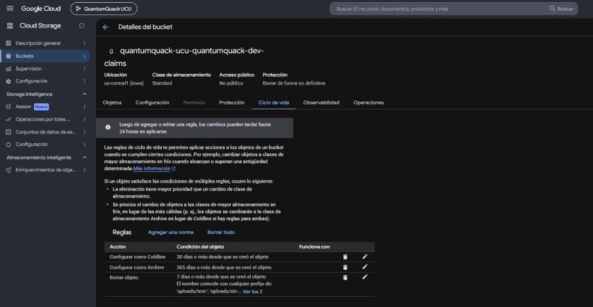

# Ciclo de vida del bucket de fotos

Bucket: `<project_id>-quantumquack-dev-claims` (`infra/modules/bucket/main.tf`). Clase inicial: `STANDARD`.

## Reglas

| # | Condición | Acción | Aplica a |
|---|-----------|--------|----------|
| 1 | `age = 30` | `SetStorageClass` → `COLDLINE` | Todos los objetos |
| 2 | `age = 365` | `SetStorageClass` → `ARCHIVE` | Todos los objetos |
| 3 | `age = 7` + `matches_prefix = ["uploads/test-", "uploads/sin-numero/"]` | `Delete` | Solo datos de prueba |

`age` cuenta días desde que se creó el objeto, no desde el último acceso.

## Por qué cada una

**1. 30 días → Coldline.** La foto de un siniestro se mira mucho mientras se tramita el reclamo (las primeras semanas) y casi nunca después. Coldline cuesta bastante menos por GB/mes que Standard, a cambio de un costo por leer el objeto y un mínimo de 90 días de almacenamiento. Para fotos que ya casi no se leen, el ahorro en almacenamiento pesa más que el costo de una lectura ocasional.

**2. 365 días → Archive.** Pasado un año, la foto solo se conserva como respaldo del reclamo (auditoría, disputas). Archive es la clase más barata para guardar y la más cara para leer, con un mínimo de 365 días. El salto a Archive pasa a los 365 días de creado, es decir unos 335 días después de entrar a Coldline. Eso supera los 90 días mínimos de Coldline, así que no hay cargo por cambio temprano.

**3. TTL de 7 días para datos de prueba.** Las fotos que subimos para probar y para la demo no tienen valor después. Se borran solas a la semana para no ocupar espacio ni sumar costo. Aplica a dos prefijos:
- `uploads/test-*`: pruebas del equipo (se usa un `claimId` que empieza con `test-`).
- `uploads/sin-numero/`: subidas sin número de siniestro. La app usa ese prefijo cuando el `claimId` viene vacío o inválido, así que no corresponden a un reclamo real.

Las fotos reales (`uploads/<claimId>/...`) **no** tienen TTL: pasan a Coldline a los 30 días y a Archive a los 365, y se conservan.

## Notas

- Las reglas 1 y 2 aplican a todo el bucket. Si una foto de prueba llegara a los 30 días ya habría sido borrada por la regla 3, así que las reglas no chocan.
- La app solo escribe (`objectCreator`), nunca lee ni sobrescribe, y cada nombre lleva timestamp + UUID. Por eso no hay versionado (ver `seguridad.md`, hallazgo de CKV_GCP_78).
