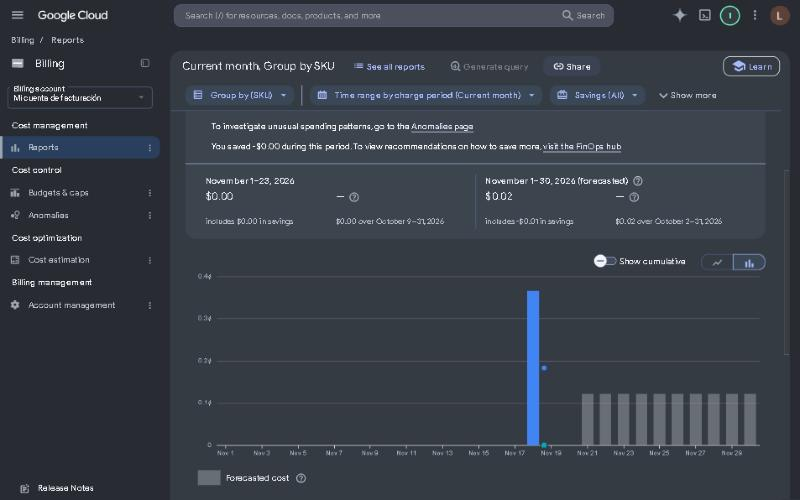
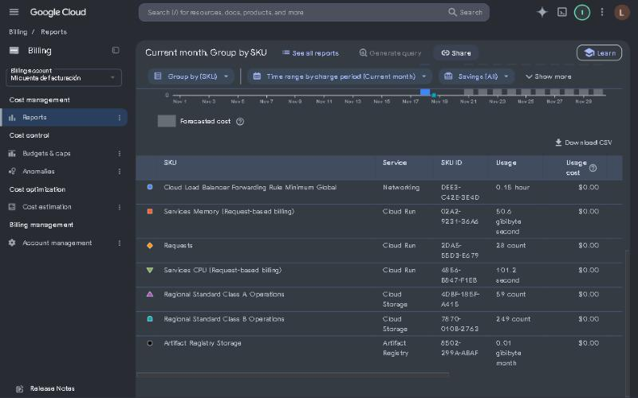

# Informe FinOps · QuantumQuack

Proyecto `quantumquack-ucu`, región `us-central1`. Datos de Facturación → Informes al 23/11/2026.

## 1. Costo real de noviembre

**Total del 1 al 23 de noviembre: USD 0,00.** El pronóstico de Google para todo el mes es USD 0,02.

El único día con costo es el **18/11**, cuando prendimos el load balancer para probarlo: una barra de unos 0,4 centavos de dólar. La consola lo muestra como USD 0,00 porque redondea a centavos.

| SKU | Servicio | Uso en noviembre | Free tier mensual | Costo |
|---|---|---|---|---|
| Forwarding rule del load balancer (global) | Networking | 0,15 h (9 minutos) | No tiene | ~USD 0,004 |
| CPU (facturación por request) | Cloud Run | 101,2 vCPU-segundo | 180.000 vCPU-s | USD 0 |
| Memoria (facturación por request) | Cloud Run | 50,6 GiB-segundo | 360.000 GiB-s | USD 0 |
| Requests | Cloud Run | 28 | 2 millones | USD 0 |
| Operaciones Class A (Standard regional) | Cloud Storage | 59 | 5.000 | USD 0 |
| Operaciones Class B (Standard regional) | Cloud Storage | 249 | 50.000 | USD 0 |
| Almacenamiento | Artifact Registry | 0,01 GiB-mes | 0,5 GB | USD 0 |

En noviembre usamos menos del 0,1 % de cada cuota gratuita. Lo único que no tiene free tier es el load balancer, y estuvo prendido 9 minutos.

Fuentes del free tier: [precios de Cloud Run](https://cloud.google.com/run/pricing), [precios de Artifact Registry](https://cloud.google.com/artifact-registry/pricing) y [precios de Cloud Storage](https://cloud.google.com/storage/pricing).

## 2. Estimado contra real

| | Justificación v1 | Real |
|---|---|---|
| Costo mensual | ~USD 0,15 | ~USD 0 (0,4 centavos en todo el mes) |

**Por qué dio menos de lo estimado:**

- **Artifact Registry.** En la v1 estimamos unos USD 0,15 por mes de almacenamiento de imágenes. Usamos 0,01 GiB-mes porque la imagen es distroless (menos de 100 MB) y la política de limpieza deja solo las 3 últimas versiones. Los primeros 0,5 GB son gratis, así que el costo real es cero.
- **Load balancer.** Es el único recurso con costo por hora y no tiene free tier. Como se crea solo cuando la variable `ENABLE_LB` está en `true`, en noviembre existió 9 minutos (la prueba del 18/11) y costó unos 0,4 centavos. El día de la demo va a estar prendido unas horas, que serían centavos de dólar.
- **El resto** (Cloud Run, Cloud Storage, Logging y Monitoring) quedó muy por debajo del free tier, porque el tráfico fue de prueba.

## 3. Proyección para producción

Supuesto: entra **1 TiB de fotos por mes** durante 12 meses, en fotos de 3 MB (unas 350.000 por mes).

### Cloud Storage (planilla [`planilla-finops-cloud-storage.xlsx`](planilla-finops-cloud-storage.xlsx))

| Escenario | Costo en 12 meses |
|---|---|
| Todo en Standard | USD 1.597 |
| Con el ciclo de vida del bucket (30 días → Coldline, 365 → Archive) | USD 593 |
| **Ahorro** | **USD 1.004 (62,9 %)** |

A eso se suman las escrituras: unas 350.000 operaciones Class A por mes, que dan **~USD 1,70 por mes (~USD 21 por año)**, iguales en los dos escenarios.

### Cloud Run

Cada foto genera 2 requests (la página y la URL firmada): unos **700.000 requests por mes**, debajo de los 2 millones gratis. El costo depende de cuánto CPU usa cada request:

| Caso | Tiempo de CPU por request | Costo por mes | Costo por año |
|---|---|---|---|
| Instancia caliente | 0,1 s | USD 0 (entra en el free tier) | USD 0 |
| Como en las pruebas, con arranques en frío | 3,6 s (101,2 vCPU-s / 28 requests) | ~USD 59 | ~USD 700 |

Con tráfico real las instancias quedan calientes casi todo el tiempo, así que el caso esperado está cerca del primero. El segundo es el techo si cada request tuviera un arranque en frío. Precios de nivel 1 (`us-central1`): USD 0,000024 por vCPU-segundo y USD 0,0000025 por GiB-segundo, con 1 vCPU y 512 MiB por instancia.

### Total estimado del primer año

| Componente | USD por año |
|---|---|
| Cloud Storage con ciclo de vida | 593 |
| Escrituras en Cloud Storage | 21 |
| Cloud Run | 0 a 700 |
| Artifact Registry, Logging, Monitoring | 0 (dentro del free tier) |
| **Total** | **~USD 614 a 1.314** |

Sin el ciclo de vida, el almacenamiento solo ya costaría USD 1.597.

## 4. Medidas de ahorro aplicadas

| Medida | Dónde | Efecto |
|---|---|---|
| Cloud Run escala a 0, con tope de 2 instancias | `infra/modules/container_service` | Sin tráfico no hay costo, y un pico no puede escalar sin límite |
| CPU solo mientras atiende requests (`cpu_idle`) | `infra/modules/container_service` | Se paga por request, no por instancia prendida |
| Imagen distroless chica (menos de 100 MB) | `app/Dockerfile` | Entra en los 0,5 GB gratis de Artifact Registry |
| Solo 3 versiones en el registro | `infra/modules/registry` (`keep_versions`) | Las imágenes viejas se borran solas |
| Región `us-central1` | Todo el proyecto | Es una de las regiones con free tier de Cloud Storage |
| Ciclo de vida del bucket: 30 días → Coldline, 365 → Archive | `infra/modules/bucket` | 62,9 % de ahorro en almacenamiento en el escenario de producción |
| TTL de 7 días para datos de prueba (`uploads/test-*` y `uploads/sin-numero/`) | `infra/modules/bucket` | Las fotos de prueba no se acumulan |
| Logs a 7 días en `_Default` | `infra/modules/monitoring` | Muy por debajo de los 50 GiB gratis |
| Load balancer solo a demanda (`ENABLE_LB`) | `infra/modules/lb` | El único recurso con costo por hora existe solo el día de la demo |
| Presupuesto de USD 1 medido antes de créditos | `infra/bootstrap` (`google_billing_budget`) | Avisa al 50, 80 y 100 % si algo sale del free tier, aunque haya créditos cubriéndolo |
